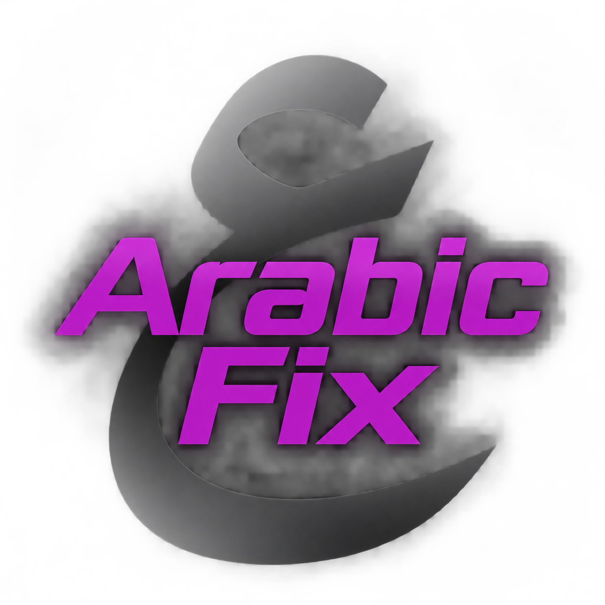
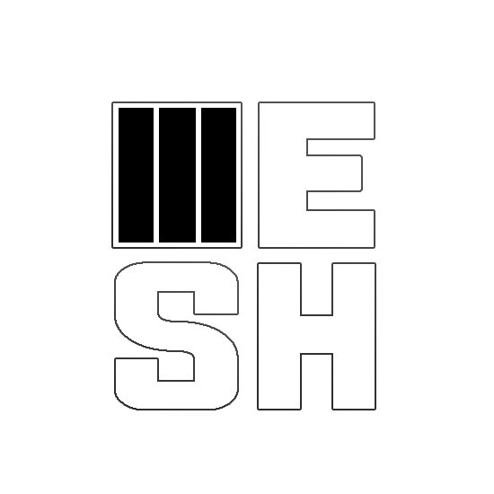

<h1 align="center">Arabic Fix ᵐᵉˢʰᵃˡ</h1>

Arabic Gaming Keyboard for Android لوحة مفاتيح الألعاب العربية

## Arabic gaming. Fixed.

Arabic Fix helps correct disconnected and reversed Arabic text in games with limited Arabic support.

| Before (illustration) | After |
| --- | --- |
| ي ب ر ع ل ا ص ن ل ا ة ب ر ج ت | تجربة النص العربي |

## Download

[Official website](https://meshx4.github.io/ArabicFix/) · [Public releases](https://github.com/MeshX4/ArabicFix/releases)

## Features

- Arabic and English layouts
- Arabic shaping and direction correction
- Editable buffer and character counter
- Local text processing; no Internet permission
- Free, no ads, no account

Compatibility varies by game; multiline text may still display incorrectly.

 <a href="https://www.instagram.com/meshal_md2/">Instagram</a> · <a href="https://www.tiktok.com/@meshal_md">TikTok</a> © 2026 Meshal. All rights reserved.

